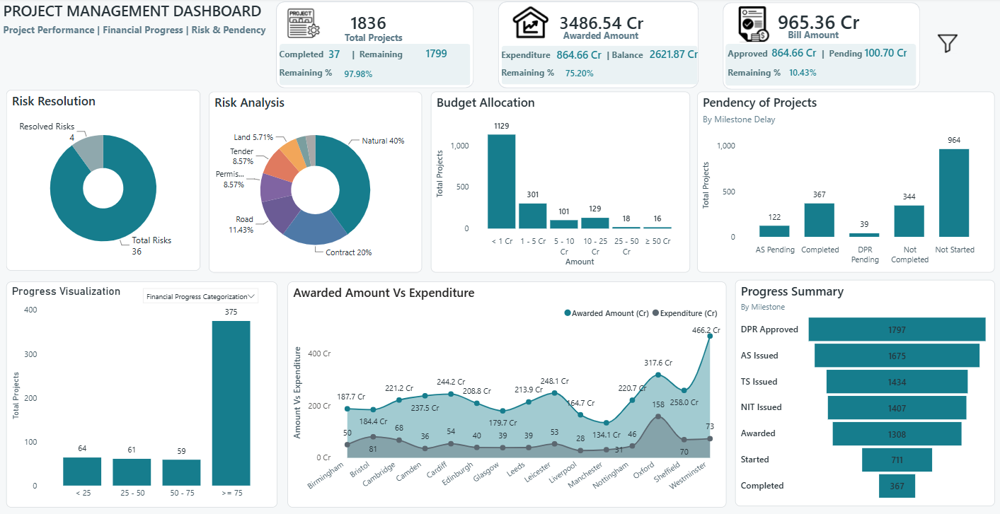
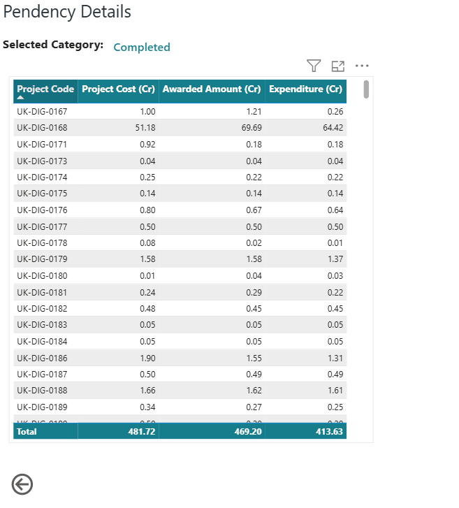
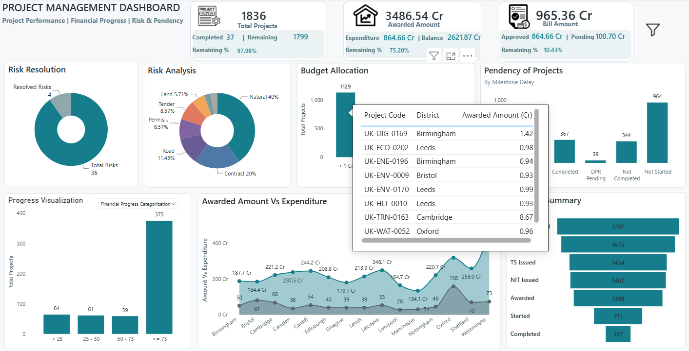

# Project Monitoring & Progress Tracking Dashboard (Power BI)

A management-review Power BI report tracking **1,800+ infrastructure projects** across financials, physical vs financial progress, risks and milestone pendency.

[Download the Power BI report (.pbix)](https://github.com/SajanaLal/power-bi-project-monitoring-dashboard/raw/refs/heads/main/PBI%20Project_Sajana.pbix)

## Dashboard

*Overview of project counts, financial KPIs, risk, budget allocation, milestone pendency and progress.*

*Drill-through to project-level cost, awarded amount and expenditure for a selected pendency category.*

*Custom tooltip displays project codes, districts and awarded amounts for the selected budget band.*

## Highlights

- **9 source tables plus 2 bridge tables**, modelled in Power Query with clean relationships
- **20+ DAX measures** covering progress, awarded amount, expenditure, billing, approvals and risk
- **Delivery-expenditure gap analysis**: compares physical progress against financial spend to flag projects that are spending without moving
- **Milestone lifecycle logic**: derives each project's stage (DPR → AS → TS → NIT → Awarded → Started → Completed) from date fields, and analyses pendency by stage
- **Report UX**: tooltip pages, drill-through, field parameters, bookmarks and a hidden slicer panel

## Report pages

- Overview KPIs: total projects, awarded amount, bill amount, expenditure and balance
- Risk analysis and resolution tracking
- Budget allocation by project size band
- Awarded amount vs expenditure by region
- Progress summary by milestone stage

## Tools

Power BI (Power Query, DAX, data modelling), Excel source data (9 tables)

## What it demonstrates

Modelling a multi-table operational dataset, writing measures that answer planning questions, and designing a report a non-technical reviewer can navigate.
